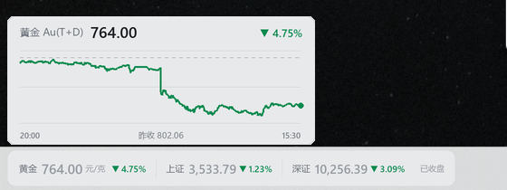

# TickerBar · 任务栏行情条

把 **黄金现货（元/克）/ 上证指数 / 深证成指** 做成一条贴在 Windows 任务栏上的实时行情条，不占桌面、不挡图标、收盘自动变灰。


鼠标悬停可展开当日分时走势：



---

## 特性

| 特性 | 说明 |
|---|---|
| 三标的同屏 | 黄金（上海金 Au(T+D)，元/克）、上证指数、深证成指，可任选显示哪几个 |
| 贴任务栏自适应 | 扫描任务栏像素找出空白区，**不遮盖开始按钮和应用图标**；任务栏居中/左对齐都能自动避让；兼容半透明/亚克力任务栏 |
| 高 DPI 适配 | 100% / 125% / 150% 缩放下自动等比缩放，跨屏拖动会重新布局 |
| 收盘自动灰化 | 按交易时段 + 行情时间戳双重判断，收盘/停更时价格变灰，**涨跌幅仍保持红绿** |
| 收盘暂停刷新 | 全部标的收盘后停止网络轮询，显示「已收盘」，到下一个开盘时间自动恢复 |
| 悬停分时 | 鼠标移到某一组上，上方弹出该标的当日分时线（含昨收基准线） |
| 轻量 | 常驻内存 50~75 MB（含 Tk/Pillow 运行时），静止时 CPU 占用接近 0；单文件 exe 14 MB |

## 快速开始

### 方式一：直接用编译好的 exe

**[下载 TickerBar.exe](https://github.com/hmc-1112/Price-fluctuation-plugin/releases/latest)**（约 13 MB，免安装）

双击运行即可。程序会：

1. 自动贴在任务栏最左侧空白处
2. 首次运行自动写入开机自启
3. 配置与日志存放在 `%APPDATA%\TickerBar\`

### 首次运行被拦截？

exe 未做代码签名，Windows SmartScreen 或国内安全软件会拦截一次，属正常现象：

| 提示 | 处理 |
|---|---|
| Windows 已保护你的电脑（无法识别的应用） | 点「更多信息」→「仍要运行」 |
| 360 / 火绒 / 电脑管家 拦截 | 选「允许本次运行」，或把 exe 加入信任列表 |
| 属性对话框底部有「解除锁定」 | 勾选并确定，该机器之后不再提示 |

要彻底消除提示只能给 exe 买代码签名证书，开源项目通常不做。介意的话建议用下面的源码方式运行。

### 方式二：从源码运行

```bash
pip install -r requirements.txt
pythonw tickerbar.py
```

> 需要 Python 3.8+，且必须带有 tkinter（官方安装包默认包含）。

## 使用说明

**右键菜单：**

| 菜单项 | 说明 |
|---|---|
| 刷新频率 | 1 / 2 / 3 / 4 / 5 秒 |
| 显示内容 | 勾选黄金、上证指数、深证成指 |
| 黄金口径 | 上海金 Au(T+D)或 伦敦金 × 汇率 折算 |
| 悬停显示分时图 | 开关悬停面板 |
| 立即刷新 | 手动拉一次行情 |
| 开机自动启动 | 勾选后写入启动文件夹 |
| 退出 | 关闭程序 |

**其它交互：**

- 行情条位置固定，不支持拖动；换分辨率/DPI 会自动重新定位
- 全屏应用（游戏、全屏视频）时自动隐藏，退出全屏恢复

## 配置

配置文件：`%APPDATA%\TickerBar\config.json`（源码运行时在脚本同级目录）

```json
{
  "interval": 2,
  "gold_source": "sge",
  "show": { "gold": true, "sh": true, "sz": true },
  "features": { "hover": true },
  "x": 8,
  "autostart": true
}
```

| 字段 | 取值 | 说明 |
|---|---|---|
| `interval` | 1~5 | 刷新间隔（秒） |
| `gold_source` | `sge` / `xau` | 黄金口径：上海金 / 伦敦金折算 |
| `show` | bool | 三组内容的显示开关 |
| `features.hover` | bool | 是否启用悬停分时 |
| `x` | int | 上次计算出的横向位置 |
| `autostart` | bool | 开机自启状态 |

## 数据源

| 内容 | 主源 | 兜底 |
|---|---|---|
| 上证 / 深证 实时 | 腾讯财经 `qt.gtimg.cn` | — |
| 上证 / 深证 分时 | 腾讯 `web.ifzq.gtimg.cn` | 东方财富 `trends2` |
| 黄金 Au(T+D) 实时 | 新浪财经 `hq.sinajs.cn`（`gds_AUTD`） | 伦敦金 × USDCNY ÷ 31.1035 |
| 黄金 分时 | 东方财富 `trends2`（`118.AUTD`） | 新浪 沪金连续（`AU0`），面板会标注来源 |

网络层策略：**直连优先 → 失败回退系统代理**，并记住上一次可用的通道，避免代理不通时长时间卡住。

> 数据仅用于个人参考，精度与实时性以交易所/行情商为准，不构成任何投资建议。

## 自行编译

Windows 下双击 `build.bat`，或手动执行：

```bash
pip install pyinstaller
pyinstaller TickerBar.spec --noconfirm --clean
```

产物在 `dist/TickerBar.exe`。

## 项目结构

```
.
├── tickerbar.py        # 全部逻辑（单文件，约 1200 行）
├── app.ico             # 图标
├── TickerBar.spec      # PyInstaller 配置
├── build.bat           # 一键编译
├── requirements.txt
├── docs/               # 截图
└── TickerBar.exe       # 编译产物（也可从 Releases 下载）
```

## 实现要点

几个踩过的坑，供二次开发参考：

- **不能真嵌入任务栏**：`SetParent` 到 `Shell_TrayWnd` 视觉上可行，但进程退出后任务栏会残留一帧残影。本项目改用「置顶 + 150ms 守护」：用 `WindowFromPoint` 检测是否被任务栏盖住，只在被盖住时重新 `SetWindowPos`，既不会盖住开始菜单，也没有残影。
- **ctypes 必须声明 argtypes**：64 位下未声明的 `HWND` 会被截断成 32 位，`SetWindowPos` 静默失败（返回 0 且无异常）。
- **Tk 打开右键菜单后会重建顶层窗口**，缓存的 HWND 会失效，守护循环里需实时用 `GetAncestor(winfo_id, GA_ROOT)` 重新取句柄。
- **工作线程不要碰 Tk**：跨线程调用 `root.after` 会阻塞，刷新周期会被拖到十几秒。改为线程只写状态、主线程定时重绘。
- **全屏判断不能只看窗口矩形**：最大化窗口的矩形会超出屏幕边界，需配合 `IsZoomed()` 排除。

## 已知限制

- 仅支持 Windows（任务栏定位依赖 Win32 API）
- 按任务栏位于屏幕底部的横向布局设计；纵向任务栏未做适配
- 港股/美股等其它标的未支持，需要自行扩展 `GROUPS` 与抓取函数

## License

[MIT](LICENSE)
